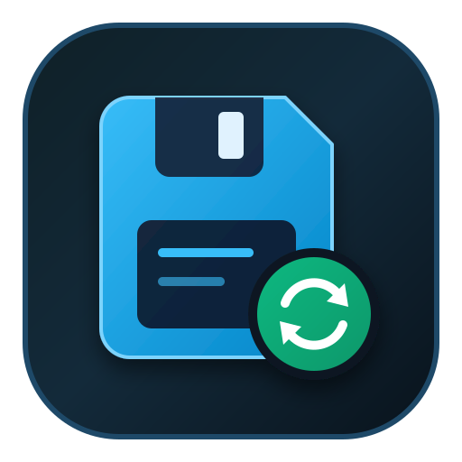
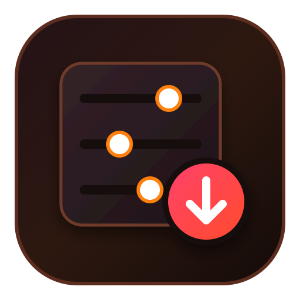

<div align="center">


# Game Manage Center

**Game Manage Center** · Game saves, trainers and MODs in one window

[简体中文](README.md) | [繁體中文](README.zh-Hant.md) | English

[](LICENSE)
[](https://github.com/LinkJudge/Game-Manage-Center/releases)
[](#)
[](https://tauri.app)
[](https://react.dev)
[](src-tauri/crates/core)

</div>

---

Game saves live in the registry, `AppData`, `Documents` and each game's install folder — and too often
get deleted along with the game. This tool puts "find saves → back up → restore" and
"find trainer → download → launch" into a single window.

A self-collected save-path library covering **52,202 games**, a three-source trainer catalog
(**FLiNG + archive + XiaoXing**, 1,284 entries), and game names in **Simplified Chinese / Traditional
Chinese / English**. The installer is only about **10 MB**.

## Features

###  Save Management

| Capability | Details |
|---|---|
| **Library scan** | Detects library roots and installed games for Steam / Epic / GOG / EA / Rockstar / Ubisoft / Battle.net; precise Steam AppID matching, multi-account paths and wildcard templates |
| **Backup** | One-click backup for single or multiple games; optional zip compression; semantic sub-folders for saves / settings / registry |
| **Auto backup** | Backs up when save files change (10 s debounce) or when a game exits |
| **Restore** | Smart conflict detection — prompts when local files are newer than the backup; restores registry entries too |
| **Cloud backup** | WebDAV cloud saves: packaged upload, cloud listing, download & restore; standard protocol, no vendor lock-in |
| **Backup manager** | Rotation limits, pinning, deletion, backup location migration |
| **Deep scan** | Full-library parsing to recover orphaned saves from uninstalled games |
| **Custom games** | Manually add any path or registry entry |
| **System tray** | Stays resident when closed; restore or exit from the tray menu |

###  Trainer Management

| Capability | Details |
|---|---|
| **Catalog search** | Search in English / Chinese / Traditional Chinese; substring / abbreviation / pinyin bridging / fuzzy correction, ranked by relevance |
| **Linked matching** | Lists available trainers for every scanned, installed game |
| **Download & install** | Measured progress (denominator from the actual response), 30 s stall detection, integrity checks, cancellable; two-level "game / package" layout, no half-finished installs on failure |
| **Installed manager** | Launch (automatic UAC elevation), open folder, delete, in-place update (new package first, then old removed) |
| **Multiple sources** | FLiNG main site 765 + archive 464 + XiaoXing 55 — **1,284 entries**; multiple sources collapse into one row |
| **Naming rules** | Shows the source's original name, falling back to the official game name when needed |
| **Leftover detection** | Trainers whose games are gone are grouped separately for one-click cleanup |
| **Defender assistant** | One click to whitelist the trainer folder |

###  MOD Management

The entry point shipped in v0.5.0; features are planned (install, version management and conflict
resolution in v0.6).

###  Settings & Updates

| Capability | Details |
|---|---|
| **App updates** | Every launch / 7 days / 30 days / never |
| **Database update** | In-app download of the latest database asset (`gm-database.db`) from Releases, verified then atomically replaced |
| **Catalog update** | Online trainer-catalog update, replaced only after full verification |
| **Three languages** | Simplified Chinese / Traditional Chinese / English, applied instantly; game names follow the same fallback (Simplified → Traditional → English) |
| **Visuals** | Glass title bar, colored feature icons plus outline icons that adapt to the light/dark theme |

###  Extensions

| Capability | Details |
|---|---|
| **Game covers** | Four-level fallback: Steam local cache → Steam CDN → EXE icon → letter tile; optional manual picking via SteamGridDB |
| **Extensions page** | A dedicated settings tab hosting covers and future extensions |

## Getting started

**Binary**: grab `Game.Manage.Center_0.5.0_x64-setup.exe` from
[Releases](https://github.com/LinkJudge/Game-Manage-Center/releases) and install (Windows 10/11 x64).

The installer bundles the v0.5 snapshot database (52k+ games). You can also download
[`gm-database.db`](https://github.com/LinkJudge/Game-Manage-Center/releases/download/v0.5.0/gm-database.db)
separately and apply it from "Settings → Saves".

**From source**:

```bash
npm install
npm run tauri dev      # development
npm run tauri build    # NSIS installer
```

Requires Node 20+, Rust stable and Visual Studio Build Tools (C++ desktop workload).

## Tech stack

| Layer | Technology |
|---|---|
| Desktop | Tauri 2 |
| Engine | Rust — `gm-core` crate, UI-independent, unit-tested (120+ cases) |
| Frontend | React 19 + TypeScript + Tailwind 4 |
| Components | Radix UI (shadcn-style) |
| Data | SQLite (52,202 games, self-collected pipeline: PCGamingWiki / Steam / XiaoHeiHe) |

The engine exposes a module registry (`crates/core/src/module.rs`) so future sources and modules
plug in without redesign.

## Project layout

```
Game-Manage-Center/
├── src/                   React frontend (pages, components, trilingual i18n)
├── src-tauri/
│   ├── src/               Tauri command layer (files, network, downloads, cloud saves)
│   ├── crates/core/       gm-core engine: scan / backup / restore / trainers / path resolution
│   └── resources/         Game database, trainer catalogs, 7-Zip
├── scripts/
│   ├── pcgw/              PCGamingWiki collection pipeline
│   ├── zh-names/          Chinese name collection (incl. Traditional, Japanese channels)
│   ├── db/                Release database export (raw responses trimmed)
│   └── preflight.py       Pre-release compliance check
└── docs/                  Data-source notes, database report
```

## Roadmap

- [x]  **Save management** — scan / backup / restore / auto backup (v0.1.0)
- [x]  **Trainers** — catalog search, download & install, launch and update (v0.2.0)
- [x] **Visuals & multi-source** — UI redesign, cover pipeline, source collapsing (v0.4.0)
- [x] **Data ownership & trilingual UI** — self-collected database, cloud saves, zh-Hans/zh-Hant/en (v0.5.0)
- [ ]  **MODs** — install, version management, conflict resolution (v0.6)

## License

 This project's code is licensed under **GPL-3.0-only** (see [LICENSE](LICENSE)).

### Data sources

| Data | Source | License |
|---|---|---|
| Game catalog, save paths | [PCGamingWiki](https://www.pcgamingwiki.com) community (self-collected incremental pipeline) | CC BY-NC-SA |
| Game names | Steam store API / XiaoHeiHe (self-collected, zh-Hans / zh-Hant / en) | Belongs to respective authors |
| Trainer catalog | FLiNG ([flingtrainer.com](https://flingtrainer.com)) public pages | Copyright of respective authors; catalog metadata only |
| Game covers | Steam CDN / local cache / SteamGridDB (optional) | Belongs to respective platforms |

**The bundled database must not be used commercially**; switch data sources or obtain permission
before any commercial use.

Trainer binaries are distributed by FLiNG officially; this app only downloads and manages them,
and **never modifies or re-distributes** trainer files. The XiaoXing source works the same way —
it only opens official pages, bypassing no license or payment mechanism.

### Third-party components

The installer bundles **7-Zip** (`resources/bin/7z.exe`, `7z.dll`) for extracting trainer archives.
Copyright Igor Pavlov; primarily GNU LGPL, with unRAR and BSD restrictions in parts of `7z.dll`.
Full license in [`src-tauri/resources/bin/LICENSE-7zip.txt`](src-tauri/resources/bin/LICENSE-7zip.txt),
source from <https://www.7-zip.org/source.html>.

Other dependencies (Tauri, React, Radix UI, Lucide, etc.) are MIT / Apache-2.0 / ISC licensed and
compatible with GPL-3.0.

### Not affiliated

This is a personal open-source project with **no affiliation, partnership or endorsement** from
PCGamingWiki, FLiNG or XiaoXing. The app name and icon are unrelated to any of them.

### Disclaimer

Trainer features are intended for **single-player games** only. Using trainers in online multiplayer
games may violate the game's terms of service and lead to bans or other penalties — use at your own
risk. This app provides no way to bypass anti-cheat, online verification or paid licensing.

Backup / restore reads and writes files inside game folders — verify target paths first. The project
is not liable for data loss caused by misuse, third-party trainers or game updates.

## Development

```bash
cd src-tauri
cargo test --workspace     # engine & command-layer unit tests (120+ cases)
cargo clippy --workspace   # lint
```

Pre-release compliance check (credentials, personal paths, oversized files, wording):

```bash
python scripts/preflight.py
```

Full notes on data sources and collection: [docs/data-sources.md](docs/data-sources.md).
