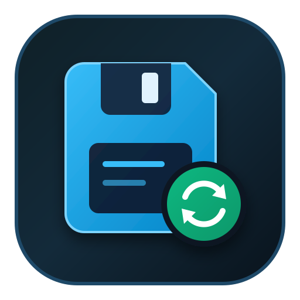

<div align="center">


# 遊戲管理中心

**Game Manage Center** · 統一管理遊戲的存檔、修改器與 MOD

[简体中文](README.md) | 繁體中文 | [English](README.en.md)

[](LICENSE)
[](https://github.com/LinkJudge/Game-Manage-Center/releases)
[](#)
[](https://tauri.app)
[](https://react.dev)
[](src-tauri/crates/core)

</div>

---

存檔散落在登錄檔、`AppData`、`Documents` 和遊戲自己的安裝目錄裡，解除安裝遊戲時又常常一起刪掉。
這個工具把「找出存檔 → 備份 → 還原」和「找修改器 → 下載 → 啟動」收進一個視窗。

涵蓋 **52,202 款遊戲**的自採存檔路徑庫，內建**風靈月影 + 舊檔 + 小幸**三源修改器目錄（1,284 條），
遊戲名支援**簡體 / 繁體 / 英文**三語顯示。安裝包僅約 **10 MB**。

## 功能

###  存檔管理

| 能力 | 說明 |
|---|---|
| **本機掃描** | 識別 Steam / Epic / GOG / EA / Rockstar / 育碧 / 戰網的庫根目錄與已安裝遊戲；Steam AppID 精確匹配，支援多帳號路徑與萬用模板 |
| **備份** | 單遊戲或批次一鍵備份；可選 zip 壓縮；按「存檔 / 設定 / 登錄檔」語義分子目錄 |
| **自動備份** | 存檔檔案變化即備份（10 秒冷卻去抖），或偵測到遊戲結束時備份 |
| **還原** | 智慧衝突偵測——本機檔案比備份新時先提示確認；登錄檔條目一併還原 |
| **雲端備份** | WebDAV 雲存檔：備份打包上傳、雲端列表、下載還原；標準協議，不鎖廠商 |
| **備份管理** | 輪換上限、永久固定、刪除、備份位置遷移 |
| **深度掃描** | 全庫解析，找回已解除安裝遊戲的殘留存檔 |
| **自訂遊戲** | 手動加入任意路徑或登錄檔項 |
| **系統匣** | 關窗可駐留背景，系統匣選單可直接還原或結束 |

###  修改器管理

| 能力 | 說明 |
|---|---|
| **目錄搜尋** | 中英繁均可檢索；子字串 / 縮寫 / 拼音橋接 / 糾錯多策略模糊匹配，按相關度排序 |
| **聯動匹配** | 按掃描到的已安裝遊戲，精確列出每款遊戲可用的修改器 |
| **下載安裝** | 實測進度（分母取自真實回應）、30 秒停滯判失敗、完整性校驗、隨時取消；安裝為「遊戲 / 版本包」兩層目錄，失敗不留半成品 |
| **已安裝管理** | 啟動（自動彈 UAC 提權）、開啟目錄、刪除、就地更新（先裝新包再刪舊包） |
| **多來源** | 風靈月影主站 765 + 歷史歸檔 464 + 小幸 55，共 **1,284 條**；同一遊戲多來源摺疊為一行，按需選擇 |
| **命名規則** | 顯示來源原名，原名非目標語言時用遊戲庫官方名兜底 |
| **殘留偵測** | 已安裝但遊戲已解除安裝的修改器單獨歸類，可一鍵清理 |
| **Defender 助手** | 一鍵把修改器目錄加入排除項，避免防毒誤刪 |

###  MOD 管理

入口已在 v0.5.0 開放，功能規劃中（安裝、版本管理與衝突排查，v0.6 實現）。

###  設定與更新

| 能力 | 說明 |
|---|---|
| **軟體更新** | 每次啟動 / 7 天 / 30 天 / 從不，四檔可調 |
| **資料庫更新** | 應用內從 Release 拉取最新資料庫資產（`gm-database.db`），校驗後原子替換 |
| **目錄更新** | 修改器目錄線上更新，完整校驗通過才替換並熱重載 |
| **三語介面** | 簡體 / 繁體 / 英文即點即換；遊戲名同步三語回退（簡→繁→英） |
| **視覺** | 玻璃材質標題欄、彩色功能區圖示 + 線稿圖示隨深淺色主題自動切換 |

###  擴充功能

| 能力 | 說明 |
|---|---|
| **遊戲封面** | Steam 本機快取 → Steam CDN → EXE 圖示 → 字母圖示塊四級回退；支援 SteamGridDB 手動選圖 |
| **擴充頁** | 設定內獨立頁籤，承載封面等擴充功能 |

## 快速開始

**直接使用**：到 [Releases](https://github.com/LinkJudge/Game-Manage-Center/releases) 下載
`Game.Manage.Center_0.5.0_x64-setup.exe`，雙擊安裝（Windows 10/11 x64）。

安裝包內建 0.5 快照資料庫（5.2 萬遊戲）；也可單獨下載
[`gm-database.db`](https://github.com/LinkJudge/Game-Manage-Center/releases/download/v0.5.0/gm-database.db)，
在「設定 → 存檔」裡一鍵更新到最新。

**從原始碼建置**：

```bash
npm install
npm run tauri dev      # 開發執行
npm run tauri build    # 打包安裝程式（NSIS）
```

需要 Node 20+、Rust stable、Visual Studio Build Tools（C++ 桌面開發）。

## 技術棧

| 層 | 技術 |
|---|---|
| 桌面框架 | Tauri 2 |
| 引擎 | Rust — `gm-core` crate，與介面無關、可獨立單測（120+ 用例） |
| 前端 | React 19 + TypeScript + Tailwind 4 |
| 元件 | Radix UI（shadcn 風格封裝） |
| 資料 | SQLite（52,202 遊戲，自採管道：PCGamingWiki / Steam / 小黑盒） |

引擎層用模組註冊表（`crates/core/src/module.rs`）為各模組預留統一接入點，後續來源與模組即插即用。

## 專案結構

```
Game-Manage-Center/
├── src/                   React 前端（頁面、元件、三語 i18n）
├── src-tauri/
│   ├── src/               Tauri 命令層（檔案、網路、下載、雲端存檔）
│   ├── crates/core/       gm-core 引擎：掃描 / 備份 / 還原 / 修改器 / 路徑解析
│   └── resources/         遊戲庫 database.db、修改器目錄、7-Zip
├── scripts/
│   ├── pcgw/              PCGamingWiki 採集管道
│   ├── zh-names/          中文名補全（含繁體、日文通道）
│   ├── db/                發布庫匯出（裁剪原始回應）
│   └── preflight.py       發布前合規自檢
└── docs/                  資料來源總表、資料庫報告
```

## 路線圖

- [x]  **存檔管理** — 掃描 / 備份 / 還原 / 自動備份（v0.1.0）
- [x]  **修改器** — 目錄搜尋、下載安裝、啟動與更新（v0.2.0）
- [x] **視覺與多來源** — 介面重做、封面鏈、多來源摺疊（v0.4.0）
- [x] **資料自主與三語** — 自採資料庫、雲端存檔、簡繁英介面與遊戲名（v0.5.0）
- [ ]  **MOD** — 安裝、版本管理與衝突排查（v0.6）

## 授權

 本專案程式碼以 **GPL-3.0-only** 授權（見 [LICENSE](LICENSE)）。

### 資料來源

| 資料 | 來源 | 授權 |
|---|---|---|
| 遊戲目錄、存檔路徑 | [PCGamingWiki](https://www.pcgamingwiki.com) 社群（自採管道增量同步） | CC BY-NC-SA（署名-非商業性使用-相同方式共享） |
| 遊戲名 | Steam 商店 API / 小黑盒（自採，簡繁英） | 各歸原作者 |
| 修改器目錄 | 風靈月影（[flingtrainer.com](https://flingtrainer.com)）公開頁面 | 版權歸原作者，僅收錄目錄資訊 |
| 遊戲封面 | Steam CDN / 本機快取 / SteamGridDB（可選） | 各歸屬原平台 |

**資料庫檔案禁止用於商業用途**；若計劃商用需更換資料來源或取得授權。

修改器軟體本體由風靈月影官方分發，本應用僅提供下載與管理，**不修改、不再分發**任何修改器檔案。
小幸來源同理——只開啟其官網 / 網盤頁面，不繞過任何授權或付費機制。

### 第三方元件

安裝包內附帶 **7-Zip**（`resources/bin/7z.exe`、`7z.dll`），用於解壓縮修改器壓縮包。
版權歸 Igor Pavlov 所有，主體為 GNU LGPL，`7z.dll` 部分程式碼另含 unRAR 限制與 BSD 條款。
完整許可見 [`src-tauri/resources/bin/LICENSE-7zip.txt`](src-tauri/resources/bin/LICENSE-7zip.txt)，
原始碼可從 <https://www.7-zip.org/source.html> 取得。

其他依賴（Tauri、React、Radix UI、Lucide 等）均為 MIT / Apache-2.0 / ISC 許可，
與 GPL-3.0 相容，各自版權與許可隨依賴套件分發。

### 與引用方無關

本專案為個人開源專案，與 PCGamingWiki、風靈月影（FLiNG）、小幸均**無隸屬、合作或授權關係**，
也未獲得其背書。應用名稱、圖示與上述任何一方無關。

### 使用須知

修改器功能僅面向**單人遊戲**。在多人連線遊戲中使用修改器可能違反該遊戲的服務條款，
導致封號或其他處罰，風險由使用者自行承擔。本應用不提供任何繞過反作弊、線上驗證或付費授權的能力。

存檔備份 / 還原會讀寫遊戲目錄下的檔案，請在操作前自行確認目標路徑。因誤操作、
第三方修改器或遊戲更新導致的資料遺失，本專案不承擔責任。

## 開發

```bash
cd src-tauri
cargo test --workspace     # 引擎與命令層單元測試（120+ 用例）
cargo clippy --workspace   # 靜態檢查
```

發布前自檢（憑證、個人路徑、超大檔案、違規措辭）：

```bash
python scripts/preflight.py
```

資料來源與採集方式的完整說明見 [docs/data-sources.md](docs/data-sources.md)。
